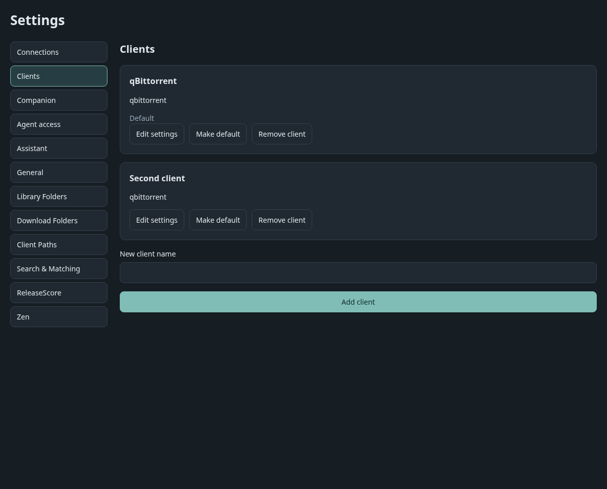
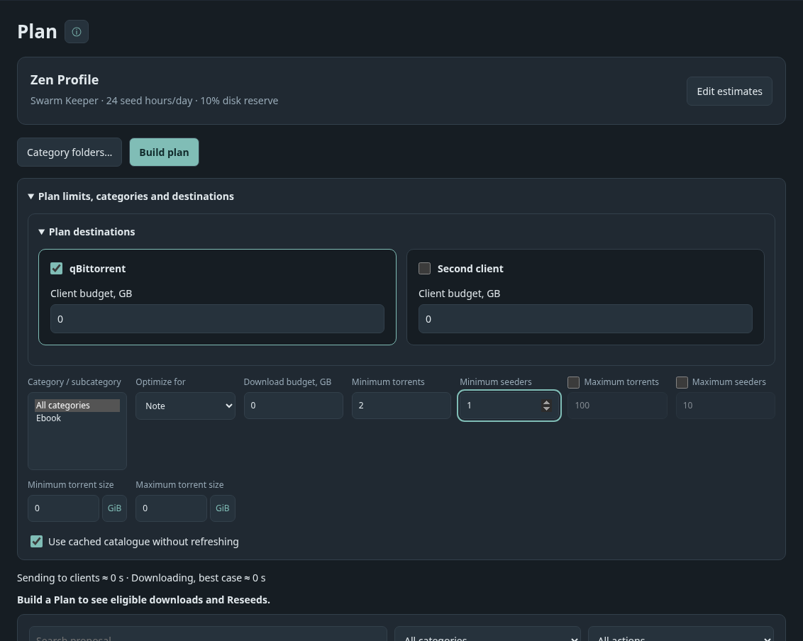

# Multiple Torrent Clients

[Documentation](../../README.md) · [Setup](getting-started.md)

## Client compatibility

This table describes what **TorrentLinker currently exposes**, not everything each Torrent Client can do on its own. A successful connection test does not prove that file paths, downloads or media playback are configured.

| Torrent Client | List / start / pause / remove | Downloads and Plans | Full Reseeds | Partial Reseeds | Sequential video downloads | Preview while downloading |
| --- | --- | --- | --- | --- | --- | --- |
| qBittorrent | Yes | Yes | Yes | Yes | Yes | Yes, with the conditions below |
| Transmission | Yes | Yes | Yes, check layout and `.part` setting | Yes, where the file layout is supported | 4.1+; older versions ignore the request | No |
| Deluge | Yes | Yes | Yes | Yes | Requested through Deluge's download options | No |
| rTorrent | Yes; removal keeps files | Yes | Yes, Link Folder required | No | No | No |
| µTorrent Classic | Experimental | Default download folder or its subfolders only | Link Folder and compatible folder/settings required | No | No through this Web UI | No |
| BitTorrent Classic | Experimental, same adapter as µTorrent Classic | Default download folder or its subfolders only | Link Folder and compatible folder/settings required | No | No through this Web UI | No |

**Preview while downloading** currently requires qBittorrent, one video file in the torrent, sequential mode and a verified downloaded start. TorrentLinker validates the live piece map before reading. A client supporting sequential downloads does not automatically support TorrentLinker's preview. Desktop playback can wait for newly verified pieces; web playback needs **Refresh preview** to extend its current byte window. See [Media preview](media.md#preview-a-video-while-it-downloads).

**Full Reseed** means all required torrent files are present. **Partial Reseed** means some files are missing and must remain skipped. The Reseed board requires a Full Match for every client; partial support applies to workflows that offer Partial Matches. See [Library and reseeding](library.md).

## File access and setup requirements

| Feature | What must be configured |
| --- | --- |
| Torrent management and Seeding overview | A working client API connection |
| Search, RSS and Plans | Indexer access; a client connection and verified Download Folder when sending downloads |
| Library scanning and file comparison | Readable Library Folders on the TorrentLinker host |
| Full-file video/music playback | Readable media files and supported player codecs; no particular Torrent Client is required |
| Upload preparation | Readable source files; tracker credentials are needed when sending, not when saving a Local Draft |
| Seeding an Upload | A supported client, reachable files and successful verification |
| Remote file transfers | Separate remote-file credentials and the destination's configuration; API access alone is insufficient |

For Docker or a remote server, configure [Client Paths](getting-started.md#your-torrent-client-in-docker-on-a-nas-or-on-another-computer). A Path Mapping translates names between hosts; it does not create a mount or transfer files.

Under **Connections → Reseed layout**, qBittorrent, Transmission and Deluge can use in-client renames or an explicit Link Folder where the layout permits. rTorrent, µTorrent Classic and BitTorrent Classic require a persistent Link Folder to preserve original file paths. Keep that folder outside Library Folders and retain it while its torrents are in use. A Link Folder does not add partial-reseed or video-preview support to a client.

## Add and select clients


Open **Settings → Clients**, or use **Clients…** beside the desktop's target selector to add a connection, edit its settings or choose the default. Give each connection a short name, such as NAS or Seedbox. Several qBittorrent instances and mixed qBittorrent, Deluge, Transmission, rTorrent, µTorrent Classic and BitTorrent Classic connections are supported.



Your existing connection is kept automatically. Each client has its own credentials, Download Folders and Path Mappings. Open **Edit settings**, test the connection, then configure its folders. Library Folders and the c411 account are shared by the application.

Category folder choices show parents followed by indented subcategories. The WebUI picker shows the full category path after selection, so repeated names stay distinguishable. A parent can have its own destination; children inherit it unless they have an override. Empty Path Mappings can be checked automatically with a temporary file and stopped test torrent, both removed afterward. The mounted folder must be writable by TorrentLinker for this check.

The **Target client** selector controls Library checks and Reseeds, Upload seeding, Search downloads and the selected client's queue. Queue entries show their client. Changing the default or renaming a profile does not redirect queued work.

In **Torrents**, select **All clients** for a combined view. Filter by name and use the context menu on selected rows to act on the corresponding clients. Removal keeps files; deletion asks before deleting torrent data. Combined Zen estimates count each torrent hash once.

## Addresses, secrets and refused logins

An address without `http://`, such as `192.168.0.50:8080`, is accepted. A wrong address names the field and what to type.

Saved passwords, API keys and tokens show as `••••••••`. Use the eye to reveal one. The extra c411 API keys are edited one by one.

If a client refuses your login, TorrentLinker stops logging in automatically until you change that client's settings or press **Test**. This protects you from a ban: qBittorrent bans an IP after repeated failed logins. When qBittorrent has banned the address, the message says so. An API key never logs in.

## Plans

Open **Zen → Plan** and expand **Plan limits, categories and destinations**, then **Plan destinations**. Each client has its own card. Check the clients that may receive the Plan and enter their budgets. Read the unit printed beside each input. A budget of zero uses available space after the disk reserve; it does not mean zero downloads.



Review the Client and Download Folder columns before sending. Distributed Plans place each torrent on one selected client and share the free-space budget when clients use the same mounted disk. They use the existing Zen heuristic and do not promise a mathematically optimal placement.

An offline destination produces a visible failure. TorrentLinker does not substitute another client. Finish or remove pending queue entries, Plans and Verifications before replacing or removing their connection.

## Web interface

Use the target selector at the top of the page. Settings has **Add client**, **Make default** and **Remove client** controls, with a name field on the connection form. Folder setup applies to the selected client.

**All clients** shows a combined overview. Select a specific client before changing torrents or starting a queue. In the planner, expand **Plan destinations**, select clients and budgets, then review the result. Each row has a destination selector before it is queued. Switching that selector uses the new destination's configured Download Folder.


The server needs access to the files for scanning, Reseeds and Upload preparation. Web downloads still require a verified mounted Download Folder. API-only seedboxes can use torrent management.

## Seedbox files over SFTP, FTPS or FTP

Without access to its files, a seedbox supports torrent management, Zen and Search. To scan, compare, Reseed, use the media center or prepare an Upload, mount the seedbox's download folder on this computer with [rclone](https://rclone.org/), then add a Path Mapping. TorrentLinker does not create the mount itself.

Prefer SFTP, then FTPS. Plain FTP sends your password unencrypted. Run `rclone config` and create a remote named `seedbox`: type `sftp`, or type `ftp` with explicit TLS for FTPS. Enter the host, user and password your provider gives you. Then mount it read-only:

```bash
rclone mount seedbox:/home/user/downloads /mnt/seedbox --read-only --vfs-cache-mode full --vfs-cache-max-size 20G
```

Replace `/home/user/downloads` with the folder your Torrent Client downloads into, as the seedbox shows it. On Windows, rclone needs [WinFsp](https://winfsp.dev/) and mounts to a drive letter such as `S:`. On macOS, it needs macFUSE.

In the client's Path Mappings, map `/mnt/seedbox` on this computer to `/home/user/downloads` on the client, or use **Detect** (**Detect matching folders** in the Web UI) once the mount is up. Use the mounted folders as Library Folders and Download Folders.

Expect these limits:

- The first scan lists every folder over the network and can take minutes on a large library.
- Upload preparation reads every byte to hash the files, which downloads the whole release through the mount. The media center reads only what it plays; the cache above keeps up to 20 GB on this computer.
- An FTP mount cannot report the seedbox's free space, so rclone shows an invented size. Set this client's budget in **Plan destinations…** instead of zero. SFTP reports free space when the provider allows it.
- A read-only mount cannot be checked with a temporary file. The check uses a file of an existing torrent instead, so keep at least one torrent in the mapped folder.
- If the mount stops, its folder becomes empty or unavailable, and a scan then finds nothing in it. Check that the mount is running before you scan.
