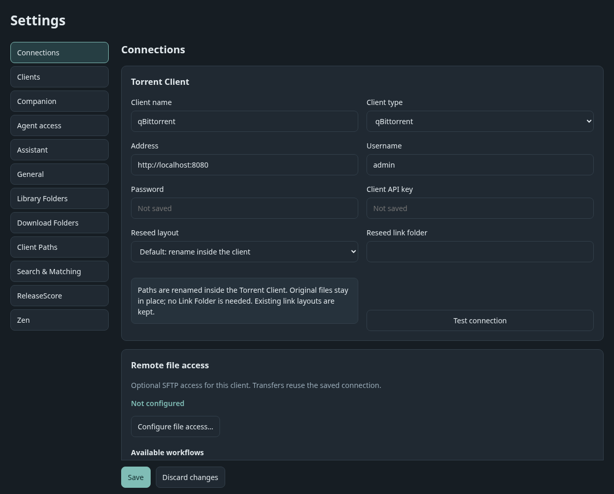
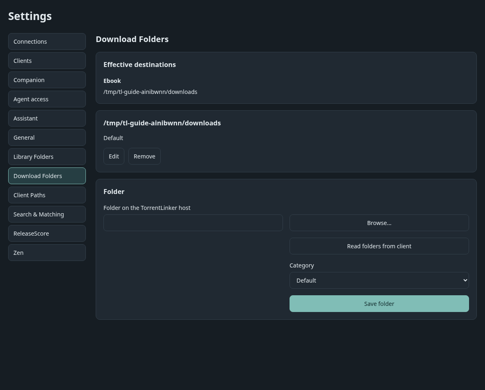
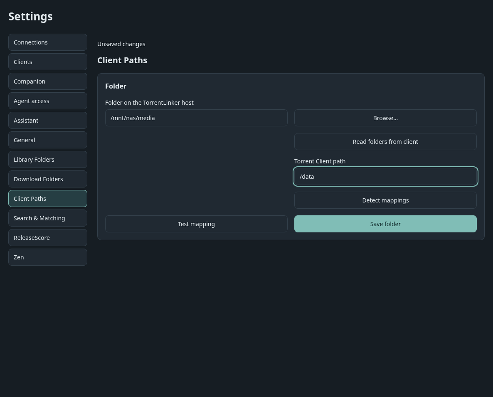

# Install and configure

[Documentation](../../README.md) · [Français](../fr/demarrage.md)

[Installation](#installation) · [Set up](#set-up) · [Your torrent client in Docker, on a NAS or on another computer](#your-torrent-client-in-docker-on-a-nas-or-on-another-computer) · [Proxy](#proxy) · [Finding your way around](#finding-your-way-around)

Start with one Torrent Client and one folder. Once a small example works, add more folders or clients.

## Installation

Download the Windows or Linux file from the [latest release](https://github.com/Vietnoirien/TorrentLinker/releases/latest). On Windows, run `TorrentLinker.exe`. On Linux, allow execution in the AppImage file properties, then open it.

Compare the [client compatibility table](clients.md#client-compatibility) if you need partial Reseeds or preview while downloading.

## What you need

| Item | Where to get it | Used for |
| --- | --- | --- |
| Torrent Client address and login | Your client's Web UI or seedbox provider | Listing torrents and starting downloads or Reseeds |
| Indexer URL and API key | Your c411 account | Searching and fetching torrent metadata |
| Access to your existing files | A local folder or a mounted share | Library scans, Reseeds, Media and Upload preparation |
| A writable Download Folder | A disk visible to TorrentLinker and the Torrent Client | New downloads and Plans |
| Announce URL | Your tracker account | Creating Uploads; you can leave it unset for initial setup |

In the Web UI, “local” means the computer running the TorrentLinker server. Choosing a folder does not upload files from your browser's computer.

## First successful setup

1. Open **Settings → Connections**. Select the Torrent Client type and enter its address and login. Click **Test connection**, then **Save**.
2. In the Indexer card, enter the URL and API key. Click **Test Indexer**, then click **Save**. A successful torrent-client test does not test the Indexer.
3. Open **Settings → Download Folders**. Set a default destination for the selected client. Add category overrides only if you need separate destinations.
4. Open **Settings → Library Folders** and add one folder containing files you already own. Choose the Content Kind that matches those files.
5. If the two applications see different paths to the same files, configure **Settings → Client Paths** using the examples below.
6. Open **Torrents** to check the selected connection. Open **Library** and scan the folder. You should see Local Items; scanning alone does not start a download.



Use the section’s **Save** button after editing. ReleaseScore has its own **Save ReleaseScore** button. Switching sections preserves a draft, but does not save it. After saving, check the status message. A saved secret may appear as an empty field marked **Saved; leave blank to keep**; do not re-enter it merely because it is hidden.

## Which settings page do I need?

| I want to… | Open | Check before leaving |
| --- | --- | --- |
| Connect or test a Torrent Client or Indexer | Connections | The relevant connection test succeeds and changes are saved |
| Add a second NAS or seedbox | Clients | Give it a distinct name, then select it before editing its folders |
| Find existing files | Library Folders | The folder is readable by the app or server |
| Choose where new files go | Download Folders | The destination is writable and belongs to the intended client |
| Translate a host path into a Docker/NAS path | Client Paths | Both paths refer to the same files |
| Tune video preferences and equipment | ReleaseScore | Profiles, equipment and the score Media's tracker rows require |
| Set seed hours, disk reserve and Zen assumptions | Zen | These are estimates used by Plans, not tracker account changes |
| Set up a model for chat | Assistant | Test the selected provider before starting a conversation |
| Pair the browser extension | Companion | The paired status appears after following the connection steps |



A Library Folder describes files you already have. A Download Folder is a destination for new files. A Path Mapping translates a path; it does not copy, mount or synchronize files.

## Set up

On first launch, or when no Indexer API key is saved, a welcome message opens connection settings. Automatic loading waits for setup. Saving the key starts loading your data without a restart. Cancelling or saving without a key leaves the app idle with a link back to Settings.

Choose the connection method for your Torrent Client:

| Torrent Client | Enable or obtain | Enter in Connections |
| --- | --- | --- |
| qBittorrent | **Tools → Options → Web UI** | Web UI address and its username/password, or its supported API key |
| Transmission | Remote access in the client preferences | Remote address and the configured login |
| Deluge | Its Web UI connected to the daemon; enable the Label plugin | Web UI address and password |
| rTorrent | The XML-RPC or SCGI endpoint from your installation/provider | Endpoint such as `/RPC2`, or `scgi://host:port`, and any required credentials |
| µTorrent Classic / BitTorrent Classic | **Preferences → Advanced → Web UI** | Web UI address, username and password |

These are the client's remote-control credentials, not your tracker login. BitTorrent Web is a different application. Client-specific Reseed limitations and file-layout choices are covered in [Torrent management](torrents.md) and [Library and reseeding](library.md).

## Your torrent client in Docker, on a NAS or on another computer



The client then sees your folders under other paths than this computer does. For example, a Docker container sees `/data`, while this computer reaches the same files as `/mnt/nas` or `Z:\`. TorrentLinker needs to know the correspondence to find the client's torrents in your folders, to Reseed, and to send a Plan's downloads where the client can write them.

In **Settings → Client Paths**:

1. Make sure the mounted folder is accessible on the TorrentLinker host. A mapping cannot create a mount.
2. Enter **Folder on the TorrentLinker host**, for example `/mnt/nas/media`.
3. Enter **Torrent Client path**, for example `/data`. This must be the path the client sees for those same files.
4. Click **Test mapping** and read the result. Fix unreachable paths before proceeding.
5. Click **Save folder**. Repeat for another mount if needed.

**Detect mappings** can suggest paths by comparing existing client files with mounted files. Choose a suggestion, test it, then save. If no match is found, enter the two paths yourself. One mapping covers everything below it; the longest matching path wins. Typical cases:

| Setup | On this computer | In the client |
| --- | --- | --- |
| Docker on this computer, volume `-v /srv/media:/data` | `/srv/media` | `/data` |
| Client on a NAS, share mounted on Linux | `/mnt/nas/media` | `/volume1/media` |
| Client on a NAS, share mapped as a Windows drive | `Z:\` | `/volume1/media` |
| Docker on a NAS, share mounted here | `/mnt/nas/media` | `/data` |

Detection and checks only talk to your torrent client.

On Windows, a mapped drive such as `Y:\` can appear in the queue as its full network path, such as `\\nas\share\`. If Transmission in Docker rejects a download with "download directory path is not absolute", compare the queue's Download Folder with **On this computer** in Client Paths. In versions through beta.27, use that same full network path on the local side. Keep the container's Linux path, such as `/downloads/complete`, on the client side. Listing existing torrents confirms the connection but does not prove that a new download's destination is translated correctly.

## Proxy

To reach the internet through a proxy, enter it in **Settings → Connections → Proxy**: `http://host:port`, `https://…`, `socks5://host:port`, or `socks5h://…` to resolve names through the proxy too, with a username and password if it needs them (the password stays in the system keyring). Every connection to c411, TMDb, the Zen Lab snapshot, images and the speed test then goes through it. Your torrent client is reached directly, as it usually runs on this computer or your network, unless you tick **Also for the torrent client**. **Test proxy** shows the address c411 sees. A new proxy applies as soon as you save.

## Finding your way around

On a small screen, resize the window to fit. The workspace scrolls when its contents no longer fit, while navigation stays visible. Use its scrollbars to reach controls on the right or at the bottom.

Use the main navigation to open **Search**, **Torrents**, **Library**, **Upload**, **RSS**, **Media**, **Zen**, **Assistant**, **Activity**, **Documentation** or **Settings**. On narrow screens, **Navigation** opens or collapses that menu.

In a torrent list, click a sortable column heading to change the order. Use the search and category filters to reduce a large list before selecting rows. Check the target client before queueing or sending work.

Use **Tab** to move between controls and **Enter** to activate the focused button. In the browser, its zoom controls enlarge the interface. Desktop sizing is under **Settings → General**. Start with a normal zoom level when learning a screen, then adjust it for comfortable reading.

## What the app tells you

Every action answers with a toast, and a button shows it is busy while it works. Known server errors appear as alerts in your language. A header bar holds navigation on a computer, a drawer on a phone. Media tracker rows say why they are empty, and **Activity** describes jobs in plain words.

## If setup does not work

| What you see | What to check next |
| --- | --- |
| Torrent Client connection fails | Open the same Web UI address from the TorrentLinker host; check its port and login |
| Torrents appear but files are missing | Check the mount and Client Paths; an API connection alone does not give file access |
| Plan has no destination | Choose the correct client and configure its default or category Download Folder |
| Library scan finds no items | Check the folder, Content Kind and scan grouping; try one small folder first |
| A saved password field looks empty | Look for the saved-secret hint before replacing the value |
| A setting seems unchanged | Save the section and read the result message; changing pages does not save |


[Documentation](../../README.md) · [Français](../fr/demarrage.md)

### AppImage GLX startup failure

On systems with newer Mesa drivers, older AppImages can bundle a `libstdc++.so.6` that is too old for the system drivers. Startup fails with `Could not initialize GLX`. On Ubuntu x86_64, this workaround uses the system libraries for one launch:

```sh
LD_PRELOAD=/usr/lib/x86_64-linux-gnu/libstdc++.so.6:/usr/lib/x86_64-linux-gnu/libgcc_s.so.1 ./TorrentLinker-x86_64.AppImage
```

Do not disable GLX with `QT_XCB_GL_INTEGRATION=none`: Qt may then fail to create the window. The fix removes these two libraries from future AppImages. The system libraries must be at least compatible with Ubuntu 22.04, the build system.


## Read guides inside the app

Click **Documentation**, just above **Settings**. Find a guide in the list on the left and select it. Links between guides stay in the app; **Back** and **Forward** return to previous pages. The language selector offers French and English guides. **Open online** opens the repository version in your browser.


Guides and screenshots ship with the app. Reading them requires no API key or torrent client connection. To run the Web UI on a NAS or seedbox, follow the [Web and Docker guide](web-docker.md).
