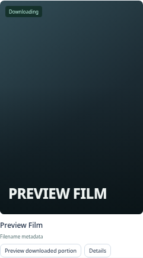
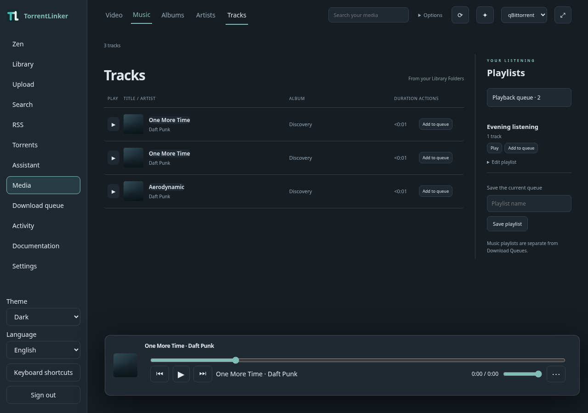

# Media

[Documentation](../../README.md) · [Français](../fr/media.md)

Open **Media** and choose **Video** or **Music**. **Add media folder** registers an ordinary Library Folder. **Refresh media** reads its media files in the background, including files that have no connection to c411. While Media is open, it reads the Library Folders again every minute and each time you open it, so new films and episodes appear on their own; the screen reloads only when something changed. Playback never edits the source files.

## Play a video

1. Add or check the folder under **Library options** on desktop or **Options** on the web, then refresh Media.
2. Choose a title and check its release or episode. Click **Play** to start it.
3. Click or tap the picture to show the controls; they hide after a few seconds while the film plays. **Audio and subtitles** in the bottom controls chooses the tracks.
4. Leave the player and return later through **Continue watching** to resume.

A video opens in a full-width theatre player above the library. The picture scrolls with the page. The large selected-film banner, with its poster, title and actions, stays pinned at the top while the rows scroll beneath it. The menu stays visible above the pinned banner. Over the theatre player it hides on scroll down and returns on scroll up, without moving the banner. A single poster click changes the selection; **Play** starts that selection. The poster keeps the same space even when artwork is missing, with a TL logo as its placeholder. The banner keeps its height when you change films. The complete synopsis scrolls within its own area when needed. Small cards show languages, genre, version and file size. Playback or download controls sit at the bottom of the banner. Open **ⓘ**, then **File details**, for the version and episode actions. **×** stops playback and returns to browsing. Leaving Media pauses a video until you return; music keeps its bar.

To remove a title from **Continue watching**, click the small **×** on its resume card. This clears its saved resume position and removes that card; it does not delete the video file.

## If playback does not start

| Symptom | Next step |
| --- | --- |
| Folder or file is unavailable | Check the local disk or mounted share on the app/server host, then refresh |
| Picture plays without sound | Try another exposed audio track or open the file in an external player |
| An audio/subtitle choice is missing | The browser may not expose that embedded track; use an external player |
| Download is unfinished | Use the explicit partial-preview action only when it is offered |

Desktop uses native playback. **Original** uses the original file and depends on the player’s codecs. With FFmpeg and ffprobe installed on the app/server host, choose **Quality → 360p, 480p, 720p or 1080p** for an H.264/AAC stream. The Docker image includes these tools. A quality or audio change briefly reloads the stream at the current film position and preserves pause state and speed. External subtitle cues follow that position. Embedded subtitles that the selected player cannot expose still need an external player.

The frosted settings menu also contains audio, subtitles, playback speed, repeat and the queue. The grey timeline shows media actually buffered by the player. Lower qualities reduce mobile data use; their hourly estimates are approximate. Conversion uses CPU on the host, keeps the original intact and writes no converted movie to disk. The Web server permits two concurrent conversions, and stopping playback or disconnecting releases its encoder. The native player uses one private loopback stream. Full films are supported; the five-minute limit was only for the prototype.

## Browse and control the library

**Options → Anime** gathers anime apart from Films and Series: recently added, the series, their OAVs as cards of their own, the films and the main genres. Home still shows everything. A video is anime when its c411 description says Japanese animation; without one, when it sits in a folder named Anime or Manga. Episode names like `Session 01`, `e01` or `OAV 2` are understood, and each OAV opens on its own episodes.

With **Show XXX content** enabled in Settings, **XXX** becomes available under **Options**. It shows only media from Library Folders of the XXX kind, which never appear in the other tabs, in Continue watching or in the Assistant's media tools. Without the setting, that media stays hidden.

Media has a compact bar with **Home**, **Films**, **Series**, **Resume**, search and Media Center. **Options** groups Music, Anime, ratings, Assistant, pre-rolls, the target client and filters. The two-colour TorrentLinker wordmark appears here only in enlarged view; otherwise it remains in the sidebar.

**Cinematic home** is the default video interface, with a featured title, continue-watching row and posters. The menu stays visible above the pinned title while the rows scroll, and choosing another poster fades the new title in; the wheel over a row scrolls that row sideways. Choose **Focus** for a large selected-title view with a compact selection strip, or **Horizon**, inspired by Kodi's Aeon Nox: the selected title's artwork fills the screen behind frosted panels with its file flags (resolution, HDR, codec, audio), and the chosen poster grows. **Horizon view** in Settings picks its screen: **Home** (the title over one category of posters: pick the category from its title, the wheel moves the selection, and the chosen poster lifts in a soft light; **See all** opens the Wall's grid), **Showcase** (one title with a carousel the wheel moves through) or **Wall** (a dense poster wall; a poster shows its title in the band above, double-click opens its details); Media's **Options** switches it too, next to the layout. Horizon stays dark whatever the theme. Media layout saved as Collection by an earlier version opens Horizon's Wall. Change **Media interface** in desktop Settings or **Media layout** in the web Interface settings; the selector in Media changes the same preference. Desktop remembers it in the app settings, while each browser remembers its own choice, like its theme. Changing layouts keeps playback, the queue and chat active. Use the compact menu for layout choices and **Library options** on desktop, or **Options** on the web for folder maintenance and additional filters. Grids load more titles as you scroll. The search control opens an integrated search field. Title details include releases, episodes and explicit partial-preview actions where available. Artwork and descriptions depend on available library metadata.

Choose **Media Center mode** in Media to make the whole app fullscreen and hide its normal navigation. Video and music browsing, the player and chat stay available. Use **Return to TorrentLinker** or **Escape** to restore the normal interface. This mode is separate from player-only fullscreen.

Video controls sit along the bottom of the picture: back and forward 10 seconds, play or pause, volume, timeline, time, **Audio and subtitles**, **Next**, **Fullscreen** and **×**. Moving the pointer or tapping the picture reveals them; they hide after a few seconds during playback. The selected title's full description sits in the banner beneath the picture. The eye icon changes the selected title's watched status and turns green when watched. Music keeps its compact playback bar.

Use **Fullscreen** in the player to show the film alone. Press **Escape** or **Exit fullscreen** to return, keeping playback and subtitles. In Media Center mode the window is full screen already: **Fullscreen** then fills the app, and leaving it keeps Media Center mode.

Video offers recent additions, continue watching, films and series. Select a card for its description, releases, episodes and available subtitles. Play uses TorrentLinker's own player and remembers your position. You can also change watched status. Genre, year and language filters use available metadata; an empty field means unknown. Files with a verified shared identity can share a card. Filename guesses alone do not merge films.

Music has visible **Albums**, **Artists** and **Tracks** tabs, square album covers, and track rows with available artist, album and duration metadata. Queue and playlist controls remain directly accessible. Add tracks to the playback queue, use shuffle or repeat, and save a named playlist. Albums in different folders remain separate editions even if their tags match. Music playlists and playback queues are separate from the Download Queue. The player stays alive while you browse other views or open chat.

The desktop player uses the codecs available to QtMultimedia. Its audio and subtitle selectors show available languages and track titles. Track choices survive seeking and fullscreen, and reset when another file starts. The web player uses the browser's codecs and track support. Some browsers play a file's video without its audio, and may not expose embedded audio or subtitle tracks. Use the external-player link when sound, subtitles or track switching are unavailable. Browser compatibility notes remain visible during video playback; a detected playback failure also shows an error. TorrentLinker does not transcode. Normal playback requires a complete file. Missing files and unavailable mounts cannot play; unfinished downloads may qualify for the explicit preview described below. A web browser can only play files accessible to the existing TorrentLinker server through its configured storage roots. Media adds no outside-network access service.

**Chat** opens Assistant beside the player and creates or reuses a discussion in the **Media** folder. It receives the current browsing context or the current video and position, or track and queue. It avoids spoilers beyond the current video position by default. A newly created Media discussion has permission to control its attached player and save playlists or watched status. Existing discussions retain their permission settings; enable **Media playback, queues and playlists** with execute mode to allow these actions. Assistant can control playback, seeking, volume, queues, audio tracks and subtitles. For example: “Play this film in English with full French subtitles”, then “Switch to French VFF and turn subtitles off”. Starting with track preferences prepares the film paused and resumes only after the player confirms the requested choices. If several tracks match, specify the track label; a missing or unsupported track leaves the film paused with an explanation. During playback, track changes use the current player’s actual inventory and do not restart the film. The same tools are available through MCP. Browser track control remains limited to tracks its player exposes. Chat always controls the player instance attached to that discussion. Another browser tab or desktop window keeps its own player session.

Configure a model connection in Assistant settings before sending a message. You can open the panel and browse your library without a model connection.

## Films on the tracker

With a c411 key, the Home and Films views add two rows of films only. **Available on the tracker**, right after your recent additions, shows c411's latest film releases that your library does not have, newest first: the first refresh reads up to 2,000 latest releases in 20 requests, later ones only what is new, usually one request. **Better versions on the tracker**, the last row, shows films you already have with a Catalogue release scoring at least 5 points more than your file; it costs no request, since your file gives the film's duration and the Catalogue every release's name and size, and it is worked out again daily. Both rows score releases with your active ReleaseScore profile when they are shown, so changing the profile or the threshold in **Settings → ReleaseScore** (90 by default) changes them at once. A tracker film's panel shows its release, score, size, sources and publication date; **Download** sends it to your Torrent Client at once, through the download queue, as **Start selected** does in the download queue. The release's category needs a Download Folder. Series and season packs are not suggested.

## Preview a video while it downloads

See the [client compatibility table](clients.md#client-compatibility) for the supported features.

For an unfinished **single-file qBittorrent sequential download**, choose **Preview downloaded portion** on the title card or featured title. It is also available in details and for unfinished episode/release choices. Other Torrent Clients do not show this action because their current adapters cannot prove the downloaded piece layout.

If preview reports that sequential mode is disabled, enable it in qBittorrent and retry after any hash check finishes. If the start of the file is not yet verified, let it download further. The action does not enable unsupported client features or treat missing bytes as complete.

On desktop it plays the file while it downloads, like qBittorrent's preview: it reads only verified pieces, and when playback catches up with the download it waits for the next pieces, then carries on. In the web player the byte window stays fixed until **Refresh preview**. Films and series TorrentLinker sends download in order, first and last pieces first. Turn this off under **Settings → Download Folders → Download films and series in order**. Other Torrent Clients and multi-file torrents do not have a proven preview layout yet. Files using qBittorrent's `.!qB` suffix are included. A format that needs the missing end of the file can remain unplayable until more is downloaded. Preview does not transcode or read download gaps.

## Music queue and playlists

Open **Music → Tracks** to choose individual tracks. **Add to queue** builds the playback queue; enter a playlist name and choose **Save playlist** to keep it. This queue is separate from the Download Queue.

## Pre-rolls and Studio

As the Owner, open **Media → Options → Pre-rolls** to import MP4 clips (H.264, up to 1080p and ten minutes), set each clip's age rating, and build sequences of fixed clips, random picks, trailers and pauses. Pre-rolls play before a new film or episode, never when you resume. **Studio** makes new clips from text, image, video and audio tracks, with keyframes, and exports MP4. It needs `ffmpeg` and `ffprobe` (the Docker image includes them). Exported clips and projects can be shared through the Community menu once the app is linked in **Settings → Join the community**.
