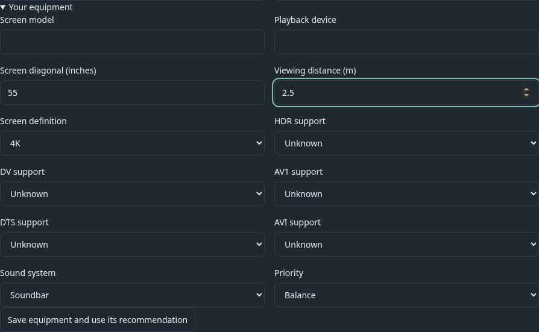
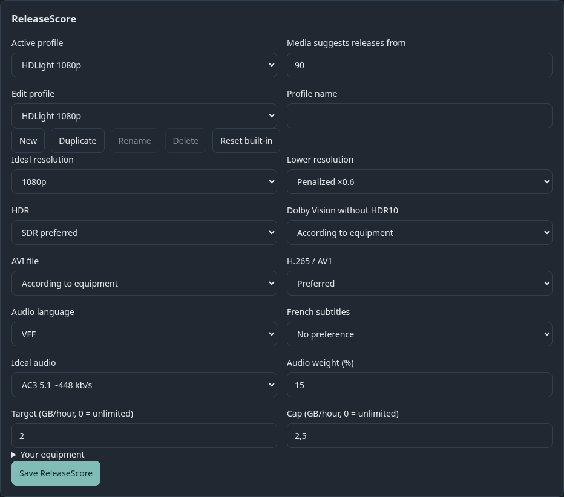

# ReleaseScore

ReleaseScore compares a release’s video and audio facts with your selected profile. The small pill in Search shows an approximate score from listing data. A question mark means there are not enough facts, including season packs without a reliable total duration. It makes no additional Indexer requests.

Colour expresses profile fit, independently of the number: green fits, yellow misses one criterion, grey misses two or more, and red exceeds the profile’s size cap. The star marks the highest scoring green result on the current page. Open a result for the MediaInfo calculation and its explanation, when MediaInfo is available. A calculated score is not a guarantee of subjective quality or playback compatibility.

## Choose a profile for your equipment

1. Open **Settings → ReleaseScore**.
2. Expand **Your equipment**. Enter your screen size and viewing distance, then choose the screen definition and sound system.
3. Set HDR, Dolby Vision, AV1, DTS and AVI support according to the device you actually use for playback. Leave an unknown capability as **Unknown**.
4. Choose your priority: saving space, balance or quality.

**Media suggests releases from** sets the score Media's tracker rows require (90 by default); see the Media guide.
5. Click **Save equipment and use its recommendation**. This creates and selects a profile based on those answers.
6. Return to Search and compare a few familiar releases. Open a result to read the score explanation before choosing it.



To tune a profile yourself, choose it in the same card, adjust its limits, then click **Save ReleaseScore**. **Duplicate** is useful when you want to keep an existing profile and try another preference. Built-in profiles can be reset; custom profiles can be renamed or deleted. Changes update open results locally.



## Read the pill before choosing a release

| Display | Meaning | What to do |
| --- | --- | --- |
| Green | Fits the selected profile | Compare the score and the release details |
| Yellow | Misses one profile criterion | Open the explanation to see which criterion |
| Grey | Misses two or more criteria | Check whether this is the right profile or release |
| Red | Exceeds the profile's size cap | Check the size limit, even if the number is high |
| Question mark | Not enough facts for a score | Inspect details; a season pack needs reliable duration facts |
| Star | Highest scoring green result on this page | Treat it as a comparison aid, not a playback guarantee |

A yellow 74 and a red 88 can both be correct. The number estimates quality; the colour reports whether that release fits your profile. A high number does not cancel a size limit. Dolby Vision, AVI, AV1 and DTS capabilities affect all profiles. Advanced Poussée scoring is not available yet.

## Credits and licence

The Rapide formula follows [ReleaseScore](https://github.com/Pilaleur/releasescore) 0.3.0 by Pila33, commit `cb65746203871d29a04acdf5447c3f662ba072cb`. TorrentLinker ports the calculation to Python. Estimates follow the author’s documented rules; they may differ substantially from measured facts.

```text
MIT License

Copyright (c) 2026 Pila33

Permission is hereby granted, free of charge, to any person obtaining a copy
of this software and associated documentation files (the "Software"), to deal
in the Software without restriction, including without limitation the rights
to use, copy, modify, merge, publish, distribute, sublicense, and/or sell
copies of the Software, and to permit persons to whom the Software is
furnished to do so, subject to the following conditions:

The above copyright notice and this permission notice shall be included in all
copies or substantial portions of the Software.

THE SOFTWARE IS PROVIDED "AS IS", WITHOUT WARRANTY OF ANY KIND, EXPRESS OR
IMPLIED, INCLUDING BUT NOT LIMITED TO THE WARRANTIES OF MERCHANTABILITY,
FITNESS FOR A PARTICULAR PURPOSE AND NONINFRINGEMENT. IN NO EVENT SHALL THE
AUTHORS OR COPYRIGHT HOLDERS BE LIABLE FOR ANY CLAIM, DAMAGES OR OTHER
LIABILITY, WHETHER IN AN ACTION OF CONTRACT, TORT OR OTHERWISE, ARISING FROM,
OUT OF OR IN CONNECTION WITH THE SOFTWARE OR THE USE OR OTHER DEALINGS IN THE
SOFTWARE.

```
