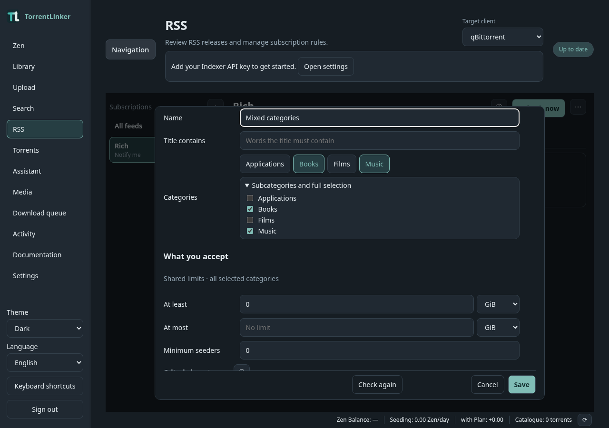

# RSS subscriptions

## Create your first subscription

1. Open **RSS → New subscription** and give the subscription a name you will recognize.
2. Enter a title or search phrase and choose categories. Start with a narrow query so the preview is easy to inspect.
3. Set any required size, seeder or quality criteria under **What you accept**.
4. Choose **Notify me** for the first run. This lets you inspect matches before authorizing downloads.
5. Read the preview count and titles, then click **Save**.
6. Open the subscription's inbox and inspect a matching release. Once the rule behaves as intended, edit it to use the queue or automatic downloads if needed.

| Mode | What happens after a match | Your next step |
| --- | --- | --- |
| Notify me | The release appears for review | Inspect it and decide what to queue |
| Add to queue | The release enters TorrentLinker's queue | Review the destination and start the queue |
| Download automatically | The rule may start permitted downloads | Configure the client, folder, limits and allowed hours first |

The editor shows hours in your local time. A new rule normally starts with future discoveries; **Include currently available releases** also considers the releases available at activation. Review that checkbox before saving.


Open **RSS** under Search to follow named c411 release feeds. Search also has a **Subscribe to RSS** button. The editor previews the feed itself. The same definition must have a successful preview within 15 minutes when creating a subscription or changing its source filters, and saving runs it for you. The configured c411 API key is reused; do not paste a private RSS URL or key into a subscription.

Each subscription follows words in the title and one or more categories, chosen by name from the indexer's category list. Categories use Torznab IDs, which differ from native Search IDs. Some native subcategories share a Torznab ID, so RSS cannot distinguish 3D objects, characters and packs through the category filter. Native Search filters such as uploader, year and category options are not copied into RSS. An ID the app has no name for stays on the subscription and shows as `#ID`.

## The subscription editor

**New subscription** (or the ＋ in the sidebar, or **Subscribe to RSS** in Search) opens one editor with four parts:

- **What to follow.** Name, words the title must contain, and categories.
- **What you accept.** Minimum and maximum size in MiB or GiB, and minimum seeders. Quality, codec, audio and subtitles are chips: click a value to prefer it, click again to require it, click again to avoid it. Preferred values show their rank, and a right-click moves one higher or lower. Type a value in **Add…** if the source uses one the editor does not list yet; after a preview the chips also offer the values the source really returns. **More criteria** holds format, bitrate, platform and license. **What matters most** is the ranking order, including seeders and smaller size.
- **What happens.** Three cards: **Notify me** (review only), **Add to queue** and **Download automatically**. The client and folder appear for the last two. Daily size, torrents per day, disk to keep free and the allowed hours appear only for automatic downloads. Hours are shown and edited in your local time (Any time, Night only, or a grid of hours) and stored as UTC.
- **How often.** Collapsed: how often to check, how long to wait for better releases, and the two checkboxes for current releases and replacing pending matches.

A strip under the editor shows "Would match now: 3 of 87 releases" with the first titles. It asks the source when you change the title or categories, and judges the fetched releases again, without a new request, when you change anything else. Saving a new subscription, or one whose title or categories changed, runs a fresh preview first, so there is no separate Preview step. **Advanced: full definition** shows the complete rule, including anything an assistant or agent set that the controls do not show.

The sidebar lists each subscription with its mode and unread count, and marks paused ones. The page header shows when it was last updated, one main button (**Refresh now**, or **New subscription** under All feeds) and a **⋯** menu with Edit, Pause or Resume, Process rules, Decisions, Delete, Compare clients and Saved selections. Selecting rows brings up Mark read, Save, Dismiss, Save selection and Add to queue. All feeds combines overlapping subscriptions by exact torrent infohash. Filter the inbox by unread, saved, in-client or queued releases. Select rows to mark them read, save or dismiss them, retain a durable selection, compare Torrent Clients, or add them to the app queue. Open a release to use the existing metadata preview. Discovery time is local first observation; publication time comes from the source and can be older or out of order.

Feeds refresh every 30 minutes by default, without an LLM. You can refresh, pause, edit or delete them. Updates read up to three overlapping pages of 100 rows and stop on repeated page fingerprints. Coverage always remains limited. A short or repeated page does not prove complete tracker history or a gap-free update. Last success, errors and the coverage reason remain visible. An activation baselines all rows currently accessible. Rules act only on subsequently discovered rows unless you explicitly select **Include currently available releases**.



## Rule modes

- **Review only** discovers releases for you to inspect.
- **App queue only** persists matching releases in TorrentLinker. It never contacts a Torrent Client or downloads a `.torrent` file. Compare clients explicitly first so the rule has a recent cached inventory. An unavailable or stale inventory blocks decisions. The queue can exceed available disk space or daily download limits.
- **Automatic downloads** uses the same queue and dispatches through the existing download permission, daily-byte, daily-torrent and disk-reserve checks. Choose the target Torrent Client and one of its configured Download Folders. A rule changes no global folder. Choose allowed hours in your local time and explicitly authorize automatic downloads in the editor. An assistant request always needs owner approval to enable or edit this mode. The queue waits when limits or the schedule prevent a start. Failed or uncertain sends require review; the scheduler does not retry uncertain downloads.

Pending entries retain their subscription, mode, work identity and selection reason in their origin. Rule decisions explain baselines, missing metadata, duplicates, waiting, alternatives and queue outcomes. Budget checks occur when a download starts, not when a wish is added to the queue.

## Release preferences

Size range and maximum size, minimum seeders, and `required` or `excluded` metadata are hard constraints. `preferred` values rank acceptable releases in their listed order. Reorder `priorities` to change which preference wins first. `prefer_small` ranks size in the size priority position. No title similarity establishes work identity. A verified film or episode identifier, or a verified namespace and work identifier for another content kind, is needed for automatic selection. Unknown identity stays visible and blocks rules; you can still review and queue a release manually.

Add `seeders` to `priorities` to prefer releases with more seeders. Its position decides whether availability outweighs quality, codec or size. Unknown seeder counts rank after known counts. This preference is separate from the hard `min_seeders` requirement.

Supported metadata keys are `quality`, `codec`, `audio`, `subtitles`, `format`, `bitrate`, `platform` and `license`. Only structured source facts count. A title token, description, NFO claim or general language label is not proof of a required audio or subtitle language. Missing required metadata blocks rules. Preferred metadata can be unknown and is ranked after known preferred values. Category-specific requirements such as music format, ebook format or 3D platform are available in the rule definition, but remain blocked when the source does not supply verified values.

For example, this accepts 1080p or 720p, prefers 1080p and HEVC, permits H264, excludes CAM and AV1, and requires verified French audio:

```json
{
  "min_size": 0,
  "max_size": 8000000000,
  "min_seeders": 3,
  "required": {"quality": ["1080p", "720p"], "codec": ["HEVC", "H264"], "audio": ["fr"]},
  "excluded": {"quality": ["CAM"], "codec": ["AV1"]},
  "preferred": {"quality": ["1080p", "720p"], "codec": ["HEVC", "H264"]},
  "priorities": ["quality", "codec", "audio", "subtitles", "size"],
  "prefer_small": true
}
```

Each preview reports exclusions, unknown fields, deterministic ranks and the work identifier. A zero-minute wait chooses the first eligible observed release. A longer wait collects alternatives before selecting the best eligible release for that work. Exact infohash deduplication is separate from work grouping. Comparisons recognize exact hashes across configured enabled clients and retain verified work identifiers independently of inbox visibility. A bounded metadata lookup can identify existing client releases. Unresolved client or app-queue work identities block automatic selection until comparison is complete; no title similarity is used to fill that gap. Manual review and queue actions remain available.

**Replace better matches while still pending** can replace a rule's own pending queue entry. Claiming an entry for dispatch is atomic. A started, sent, failed or uncertain entry is never silently upgraded or replaced. These rules do not upgrade existing downloads.

Preferred fields omitted from `priorities` are appended in their declared order, so a format or platform preference is never silently ignored. The same applies to `size` when `prefer_small` is enabled.

## Assistant and MCP

Use `list_feeds`, `preview_feed`, `refresh_feed`, `feed_inbox` and `compare_feed_clients` to inspect discovery and clients. `select_feed_items` saves an exact durable selection; `get_feed_selections` recovers its ID after context loss. `process_feed_action` handles subscription save/edit/pause/delete, mark actions, rule evaluation and enqueueing a saved selection through existing owner permissions. Supply stable request IDs for mutations. Native search filters are not RSS parameters. Automatic polling and dispatch do not call an LLM.
