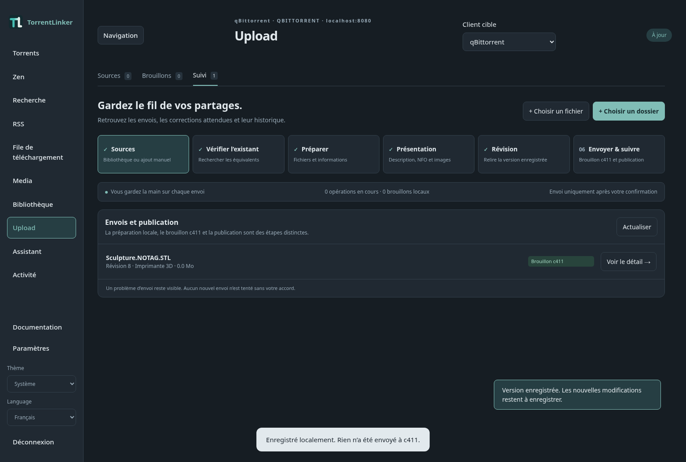

# Prepare a c411 upload

## First Upload: save, review, then send

1. Select the Torrent Client that will seed the files. Confirm the files are accessible from TorrentLinker and that client.
2. Choose a Library source or add a file/folder in **Upload**. Check for an existing matching torrent before preparing a new Upload.
3. Open the draft and complete its category, name, description, NFO and required category options. Follow the visible category checks.
4. Add a hosted image URL where required. A preview image in the editor alone does not mean it has been uploaded to an image host.
5. Click **Save draft** or **Save locally**. Open the saved preview and read the findings. Correct missing information and save again.
6. Choose **Send to c411…** only after reviewing that saved revision. Final publication is completed on c411.

| Action | Where the work goes |
| --- | --- |
| Save locally / Save draft | TorrentLinker's local storage; no c411 publication |
| Preview saved draft | Displays the saved revision for review |
| Send to c411 | Contacts the tracker and creates the remote draft |
| Publish on c411 | Makes the tracker submission public through c411's own workflow |

If a send times out with an unknown outcome, inspect your c411 drafts before retrying. If the source files changed, save and review a new revision first.

Upload uses the same list and inspection layout on desktop and Web, with **Sources**, **Drafts** and **Tracking**. Sources suggest Library items with no Candidates or rejected Candidates; these are leads to review, not proof that a release is absent. You can also choose a file or folder manually. Web pickers browse the server's storage roots.

The guided steps are **Sources → Check existing → Prepare → Presentation → Review → Send and track**. Save the draft, review the saved revision and confirm each send to c411. Editing invalidates that review. Final publication remains on c411. An uncertain send must be checked on the site before retrying.

In Presentation, **Add image** opens Postimages. Choose and upload your image there; its returned direct link is inserted into the presentation when saved. Allow the popup. If hosting fails, the description is preserved and you can retry or paste a direct link. Files and images go to the selected host only when you choose them there.

The advanced editor remains available for category options, model tools and detailed file review. The sections below describe that editor.

## Editor sections

Desktop and WebUI use the same sections for a saved Local Draft:

| Section | What to review |
| --- | --- |
| Details | Release name, Upload Category, subcategory and Category Options. |
| Files & NFO | Saved file list and NFO text. |
| Description | Presentation text and its preview. |
| Artwork | Hosted image URL and model preparation tools. |
| Review | Refusals, warnings, current saved revision and confirmation before sending. |

Switching sections does not save changes. Use **Save locally** before previewing or sending the saved revision. **Local drafts**, **New draft** and **c411 drafts** distinguish local work, preparation and the drafts already on the tracker.

[Documentation](../../README.md) · [Français](../fr/upload.md)

1. Search the Library item for matches. Orphans with no results appear in **Upload**.
2. Select the item and category. Review refusals, warnings, name, files, NFO and description.
3. Add the direct URL of your hosted image.
4. Save to the local queue and review the presentation. Send it to c411 when ready, then publish it there yourself.

Screenshots use the English interface, dark theme and example data.

## Review in the local draft queue

Click **Save draft** in preparation, or **Save locally** in the saved editor, to keep work in TorrentLinker. Open **Local drafts** on desktop or web. Select a draft to inspect its files, description and NFO, edit the presentation, and save your changes locally.

**Preview saved draft** opens the same review dialog as Assistant cards, with artwork, description, NFO, files, category options and review findings. It shows the saved revision, so save any editor changes first. Previewing does not approve or send the draft.

Local drafts survive restarts and belong to the selected Torrent Client. They stay on the computer or server running TorrentLinker. Saving does not create a `.torrent`, send anything to c411 or start seeding. You can save an incomplete draft without an Announce URL and correct it later.

When ready, save your changes and choose **Send to c411…**. Both interfaces ask you to check the review box. TorrentLinker checks the saved revision, current files, required category options, hosted image, description and NFO. Sending needs your Announce URL and c411 draft credentials. If files changed since review, save and review again.

The desktop follows its usual verification and seeding workflow after a successful send. Web and MCP offer seeding as a separate action. Final publication remains manual on c411.

Removing a local draft removes only the queue record. It leaves your files and any c411 Draft untouched. If a send fails or is interrupted, check c411 before **Allow retry after checking c411**. The app does not automatically repeat an uncertain send.

Automated Upload tasks save here for review. MCP can list, edit and remove local drafts, but sending always requires approval of the saved revision. An edit invalidates an older approval. See [Agents and MCP access](agents.md).

## Prepare a c411 Draft

The **Upload** tab lists Orphans from every Library Folder that a search found no Match for: c411 may not have them yet. Each is made for one c411 **category**, picked in the form: the Library Folder's Content Kind proposes it (3D models → Imprimante 3D; movies and series, ebooks, music and games propose theirs), and an item of kind *Other* asks you to choose. **Imprimante 3D**, **Ebook**, **Audio**, **Films & Vidéos**, **GPS**, **Emulation**, **Applications** and **Jeux Vidéo** can be uploaded so far; the other categories show "not supported yet" until their rules are added. Changing the category redoes the checks, subcategory, name, NFO and description. Enter your **Announce URL** (from your c411 profile) in **Settings → Connections**, and use a main API key with the **Brouillons d'upload** (`drafts:rw`) scope.

Use the search bar above the Upload list to filter Local Items by filename. It works alongside the Content Kind and **Show all** filters.

Selecting an item also searches c411 for what it **already has** of it (the item's title words, within its category) and lists the releases found, with size, seeders and a link, in a collapsible **Already on c411** box; "Nothing found on c411" when there are none. It is information only: Team Pending refuses duplicates, and the app does not decide them. Each item is searched once per session, only when you select it, through the same key budget as every search.

For the chosen item, TorrentLinker checks c411's 3D rules: those a program can check (accepted formats, no archives) are red **Refusals** that stop the Draft, while those only you can judge (no files from independent creators who live off them, one coherent theme for a pack) are amber **Warnings** that leave the Draft available. It suggests a release name such as `Petit.Etau.De.Bureau.NOTAG.3MF` (dots between words, no accents, `NOTAG` when the source is unknown), makes a private torrent with c411's piece size and `source = C411` tag so its info-hash stays the same when published and an NFO listing every file, and saves them as a Draft on c411. The torrent then joins your torrent client against your own files, renamed inside the client as a Reseed is, so your files keep their names; it seeds once Verification passes.

Below the subcategory, click **Options** to show the choices c411 asks for: language, genre, format and so on. This section starts collapsed to leave more space for the description and NFO. Collapsing it keeps your choices; its open or closed state is retained during the session, including when options are refreshed. Loading errors, the retry button and missing required options remain visible while the section is collapsed. Selectors use checkboxes for multiple values and a drop-down for one; required options carry an asterisk. TorrentLinker reads them from c411 the first time a subcategory needs them, keeps them for a week (**Refresh options** reads them again), and a category's rules can pre-fill them; what you choose wins. A required option left empty blocks the Draft, and Imprimante 3D has none. Open c411's upload page, load the Draft, add the image the rules ask for (see below), and publish it there. See [ADR-0011](../../adr/0011-uploads-start-as-c411-drafts.md) and the [rules summary](../../research/upload-rules.md).

### The image for the description

c411's image upload only accepts a logged-in browser, so TorrentLinker renders the model itself. **Artwork** provides the model tools; on desktop choose **Open model tools…**. The 3D view shows the chosen item's model (STL, binary or ASCII; OBJ; 3MF) at an isometric angle, framed on its bounding box: drag to rotate, scroll to zoom, double-click or **Reset the view** to start over. A folder with several models offers each in a list. Big meshes are read off the interface thread and thinned for display only.

- **Capture** saves the current view as a PNG at least 1000 px wide.
- For a **Pack**, **Capture the Pack sheet** saves a grid of up to 9 models, each seen from the isometric angle with its file name below.
- **Open the folder** shows the images, which are in `uploads/<release name>/` (never in your Library). Add the one you choose on c411's upload page while reviewing the Draft; the description keeps an `[img]…[/img]` placeholder for it.

If you host the image elsewhere, paste its direct URL into **Hosted image URL**. **Host image…** opens Postimages. The image is included in the Draft description even after you edit the text; changing the URL updates the image without resetting your presentation.

STEP, GCODE, BLEND, F3D, SLDPRT and FCStd items show no preview and say so: make that image yourself. Rendering needs OpenGL; without it the view and captures are unavailable and the message says why.

## Rules for each category

See [category rules](upload-categories.md) for formats, naming, checks and metadata for ebooks, audio, video, GPS, emulation, applications and games.

[Documentation](../../README.md) · [Français](../fr/upload.md)

### Complete the presentation before showing cards

The Assistant uses `preview_upload` to inspect a Library item, `get_upload_requirements` to read the category template, and `save_upload_draft` to save or correct it. These tools are also available through MCP. Upload category IDs differ from Catalogue IDs; calling `get_upload_requirements` without a category lists the supported IDs and subcategories.

You can save incomplete Local Drafts. Preview and validation identify each missing description or NFO field by name. Keep the template's technical labels and fill the presentation/synopsis section. Unknown values and placeholders do not count as completed fields. Conditional requirements include WEB platform, audiobook details, lossless audio bit depth and individual track durations. EPUB language metadata is checked when available; a foreign-language file cannot be made eligible by labelling it French.

The Assistant cannot display incomplete drafts with `present_upload_drafts`. It must correct the saved form and present the new revision, or ask you for the missing facts. The queue preview remains available so you can inspect unfinished work. All sends recheck completeness before hashing or contacting c411, on both desktop and WebUI. Complete fields do not guarantee factual accuracy or tracker acceptance: category refusals, duplicate checks and human review still matter. Preserve original release NFOs; standard video MediaInfo text is recognized without rewriting it.

