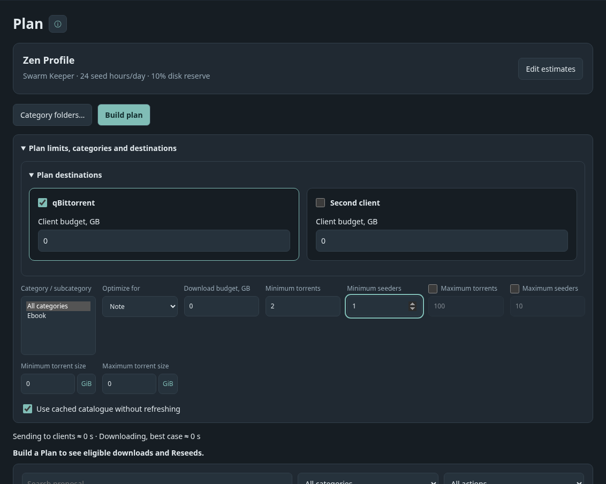

# Track Zen and make a Plan

[Documentation](../../README.md) · [Français](../fr/zen.md)

Use **Seeding** to inspect torrents already in your clients. Use **Plan** to propose what to add next. Building a Plan does not start it.

## Profile and browser companion

**Profile** is the first Zen tab on desktop and WebUI. The header shows your
Class, level, team and membership date, with badges for download access, freeleech
and how fresh the API and companion data are. Below come your ratio, buffer,
transfer totals, Zen Balance and active seeds; charts of volumes, Zen and ratio;
progression; Zen earned, spent and estimated from your Torrent Clients; transfer
accounting with credit; active seeds on c411 against each Torrent Client; and a
calendar of the last 26 weeks of syncs.

TorrentLinker keeps one row of profile history per day, from the day you start
using this version. Charts, trend lines and changes over the chosen period
(7 d, 30 d, 90 d or All) appear once two days are recorded. Changing the indexer
or its key starts a new history. The profile refreshes every two minutes while
the desktop app is running or the WebUI Profile tab is visible. **Refresh**
requests an immediate update; errors appear alongside the last successful values.

The optional Chrome, Brave or Edge companion adds active seed count, validated
uploads, total seed time and transfer statistics. Manage its installation and
connection in **Settings → Companion**. That page also offers the optional
**Download .torrent files with my c411 session** setting, which is off by default.

See [Browser companion](companion.md) for installation, remote WebUI setup,
session downloads, exchanged data, pausing, updates and troubleshooting.

## Zen integration

The Zen tab brings together c411's reported balance and TorrentLinker's earnings estimates:

- Read your Zen Balance, Class, unlocked progression-tree bonus, and download eligibility from your c411 profile. The Indexer API key needs the `profile:read` scope for this, in addition to catalog/download access.
- Estimate Zen/day for each torrent currently seeding in your torrent client and for Matches found in the Library, using size, seeders, seed age, category, Class bonuses, and the configured seed hours per day.
- Compare Tanker, Swarm Keeper, and Reuploader. Reuploader estimates use the upload count entered in the Zen tab and are approximate.
- Set Class, unlocked tree bonus, seed hours per day, and an overall torrent cap in **Settings → Zen**. Values supplied by c411 fill the Class and tree bonus automatically when profile access is available.

Without profile permission, you can enter the Zen Profile by hand and use estimates and planning. The displayed balance comes from c411; projected earnings and payback are local estimates. The client's seed age is a lower bound when a torrent has been removed and added again.

### Find torrents in a large seeding list

Start with the torrent-name filter, then narrow the results by category, tracker or tag. The shared torrent rows keep names and metrics aligned. Click a sortable column heading to change order; use the page controls to browse a large collection. Filters limit the displayed rows, while the overall totals describe the collection.

Expand **Category totals** when you want category summaries rather than individual rows. Unknown or broad Catalogue categories remain visible as such. They do not establish an exact subcategory match.

For multiple clients, check the selected client before comparing values. **All clients** counts each torrent hash once. An unreachable client can leave an incomplete observation; refresh it before treating the totals as current.

## Make a Zen Plan

1. Choose the target client and configure its Download Folders first.
2. Expand the Plan control card. Under **Plan destinations**, check the client cards to use. Leave only one selected for a first trial.
3. Choose categories, a download budget, minimum torrent count and minimum seeders. Start with a small budget you are willing to download.
4. Choose **Build plan**. Review the proposed torrents, client, Download Folder and disk space remaining.
5. Adjust the controls and create a new Plan if the proposal is unsuitable. Changing an input does not retroactively approve an old result.
6. Select the rows you want and use the queue or send action. Read the confirmation before sending.

Collapse the control card to give the results more room. Use the **ⓘ** beside the Plan heading for explanations without leaving the page.

| Control | What it means | Example |
| --- | --- | --- |
| Download budget | Total size of new downloads; zero adds no extra limit | Enter 20 with a GB label to budget 20 GB |
| Minimum torrent count | Desired number of torrents in the built Plan | 10 asks for at least 10; it is not a file-size limit |
| Minimum seeders | Lowest seeder count allowed for each candidate | 2 excludes candidates with 0 or 1 known seeders |
| Maximum torrents | Optional upper count; enable its checkbox first | 50 limits the Plan to 50 torrents |
| Maximum seeders | Optional upper seeder count | Use it only when you want less populated swarms |
| Minimum / maximum torrent size | Bounds for each torrent, not the whole Plan | Read the unit beside each field; zero maximum adds no cap |
| Optimize for Note | Favors the initial Note for your Class; ties prefer smaller downloads | Use when individual torrent Note matters most |
| Optimize for Zen/day | Favors estimated total earnings | Compare the proposal's size and estimated gain |
| Use cached catalogue | Builds without refreshing catalogue data first | Useful for a quick trial; counts may be older |

The minimum count does not override disk space, categories or other limits. If the Plan cannot reach it, read the shortfall message, loosen a constraint or add suitable catalogue entries, then build again. The minimum-seeder count and minimum-torrent count answer different questions.

New settings default to **Note**. Saved choices are preserved. Each candidate is scored using the current seeder count including your arrival, with zero cumulative seed days. Its score can rise as you keep seeding. The displayed size-weighted average is a summary, not the selection objective. This applies to single-client and distributed Plans.

Reseeds come first. They count toward the torrent limit and consume no download budget. The overall torrent cap and disk-space reserve also apply. The results show each torrent's note, the size-weighted average note, estimated Zen gain and payback, and free disk space before and after the Plan. Download Folders sharing a physical disk are counted once. Plan options are saved across restarts.

A Plan leaves out every torrent already in your torrent client, whatever its tracker or state. It also leaves out Catalogue torrents that seem to be in your Library or in the Plan's Download Folders already, such as files kept after their torrent left the client: a Local Item, or one of its files, of the torrent's size (or up to 64 KiB smaller, for an .nfo or cover) whose name shares most of its significant words, with no other volume number. The Plan says how many it left out; hover over its summary to see them. No request is made for this, so only a search in the Library confirms a Match, which you can then Reseed instead of downloading.

Each Plan shows two estimated times. **Sending** to the client follows c411's limit on `.torrent` downloads: 30 a minute per API key, and about 280 in 20 minutes, so more keys send faster (1,000 torrents take about an hour with one key, 7 minutes with five). **Downloading** the data is the Plan's size divided by your download speed. **Test speed** measures that speed for about 8 seconds with Cloudflare's public speed test, anonymously, and remembers it. The download time is a lower bound: torrents with few seeders download slower than your connection. Run the test while your torrent client is idle.

Sending a Plan downloads each `.torrent` directly from c411 and adds it to its Download Folder. TorrentLinker refuses downloads that would overwrite existing files. Normal Reseeds still go through hash Verification.

A progress bar shows how many torrents have been sent, added, refused, or failed, with an estimate of the time left. **Stop sending** ends after the current torrent. If c411 refuses downloads (HTTP 429), sending waits and retries the same torrent, waiting longer each time up to 15 minutes, and shows the next try time.

The Plan and each torrent's result are saved as sending goes. After you stop sending, close the app, or after a crash, the Plan comes back with only the torrents left to send; failed ones are tried again. Click **Send to the torrent client** to continue. Making a new Plan or changing its options replaces the saved one. Reseeds are not saved, but sending always starts with them.

An empty Plan states the observed blocker and what to change: total torrent cap, filters, missing folders, existing torrents, no seeders, Zen profile or insufficient budget. Catalogue exclusions include counts. The total cap in **Settings → Zen** is separate from the Plan's torrent limit.

### Catalog updates and provisional estimates

The app ships with a copy of the c411 Catalogue, made with Zen Lab, and imports it at its first Catalogue refresh, without any network request. A build without it, such as one run from source, imports Zen Lab's public metadata snapshot anonymously at the first Plan instead. Your c411 API key and all `.torrent` requests go directly to c411.

c411 allows your account 1,200 searches and Catalogue requests an hour, whatever the key, and limits each key's `.torrent` downloads to 30 a minute. TorrentLinker keeps the two apart: searches go up to two a second while the hour's budget lasts, then slow down, even while a Plan is being sent; each key's downloads keep to 30 a minute and about 280 in 20 minutes. Your own searches, file checks and Reseeds always go before a Plan being sent or a Catalogue update. If c411 asks every key to wait more than half a minute, they stop at once and tell you when to try again, instead of hanging. You can add up to 4 more keys of the same c411 account in **Settings → Connections → More API keys**: each adds its own download allowance, and requests go to whichever is free soonest (see [ADR-0008](../../adr/0008-several-c411-keys-each-within-its-own-limits.md)). See [the measurements](../../research/rate-limits.md).

Planning and startup refresh c411 newest-first, stopping at the previous successful update's checkpoint, or an already known page on the first update. Historical scans and their saved page positions are reserved for the explicit Catalogue fetch action. **Zen → Catalogue** shows one card per c411 category: how many of its torrents the Catalogue holds against c411's own count, and whether it is up to date, being read, paused or never read. **Fetch all categories** reads them one after the other; each card's ⟳ button fetches that category alone. Either way, a category is read again in full, then each of its torrents the fetch did not see is checked on c411, so it ends at parity with the site. c411's listing returns at most 100 pages per query, so that action then reads each bigger subcategory oldest-first and year by year (the release year), each year being small enough to read in full. A new fetch reads every reachable page again from scratch, and resumes where it stopped after a pause. Once it completes, each torrent outside XXX that it did not see is checked on c411: the deleted ones leave the Catalogue for good. Only torrents without a year that are neither among the newest nor the oldest stay out of reach: 473 of 63,974 films when this was measured. c411's listing leaves out XXX, which only its search returns. Interrupted updates retain their checkpoint and check for new arrivals when resumed. While the app or the web server runs, every category is refreshed this way every four hours, so the whole Catalogue stays current. These refreshes wait for any other Catalogue work, and your own searches go first.

A paging-limit warning means the Indexer stopped exposing older pages. Cached torrents remain available for Plans; repeating the fetch does not remove the server limit. A paused fetch is different: it has unfinished work that can be resumed.

Plans use cached metadata and show provisional estimates. There are no per-torrent c411 metadata checks before planning or sending. The torrent client is read every 30 seconds to update Seeding estimates as tracker responses arrive. Its known swarm counts also update the local Catalogue for future Plans; unknown counts retain the cached estimate.

If another Catalogue refresh is running, the Plan waits for it and then refreshes its selected categories. If a refresh fails while the Catalogue already contains torrents, the desktop Plan uses the cached data and shows a separate notice. Without any cached data, the error stops Plan creation. You can stop fetching and make a Plan from the data already available.

The snapshot has coarse categories and unknown upstream age. Broad entries are excluded from narrower subcategory selections until the local Catalogue has a specific category from c411. Selecting the parent category allows the broader set. Seeder updates from the client preserve that category uncertainty. c411's paging limits and the snapshot do not establish complete tracker coverage, and the app reports known limits. Zen values remain estimates.

See [CONTEXT.md](../../../CONTEXT.md) for the vocabulary and [docs/adr](../../adr) for the design decisions.

[Documentation](../../README.md) · [Français](../fr/zen.md)

### Web planner controls

The web interface has separate **Seeding**, **Plan** and **Catalogue** tabs. Plan uses the desktop selection and sending engines. Select multiple categories or subcategories, optimize for Zen/day or Note, set optional torrent and seeder limits, and distribute downloads across clients with separate budgets. Read the displayed units: GB and GiB are different, and the per-torrent size unit can be changed. Zero adds no budget or maximum-size limit. Categories and planning limits survive restart.

For a single destination with no per-client budget, checked Library Full Matches join the Plan as zero-download Reseeds. As on desktop, distributed Plans contain downloads only. Size, seeder and torrent limits apply to both downloads and Reseeds. Files already in the Library or Download Folders are excluded and listed for review.

Review total size, added Zen/day, payback, the size-weighted average Note, and disk reservations. Folders on the same physical disk share one capacity calculation. Sort and select across pages, then choose **Send selected to clients…** or **Queue selected downloads**. Direct sending asks for confirmation. Reseeds go through hash verification; µTorrent disk renames require an additional review of every old and new path. **Stop after current torrent** retains unsent downloads, which also survive a server restart. Session-only Reseeds must be rebuilt after restarting the server. Failed rows remain available to retry; refused rows and successful sends leave the Plan.

Use **Category folders…** to browse the TorrentLinker host and verify destinations. These are server paths, not paths on the browser's computer. **Zen profile, disk reserve & exclusions** holds the planning settings. You can enter a download rate or test the server connection; that estimate may differ from a remote torrent client's connection. The sending estimate uses the configured API key count. Additional keys are stored privately under **Settings → c411 → Advanced settings**; saved key values are never returned to the browser.

Changing planning inputs requires a new Plan before sending. You can stop Catalogue fetching and build from the cache. A failed refresh uses an existing cache with a visible notice; an empty cache leaves the error visible.

The Catalogue tab shows cache age and coverage, including paging limits and imported snapshot metadata. Its history fetch can be paused after the current page and resumed. Updating it does not send any downloads. In **Seeding**, the upload count used for Class comparison is editable and saved.
