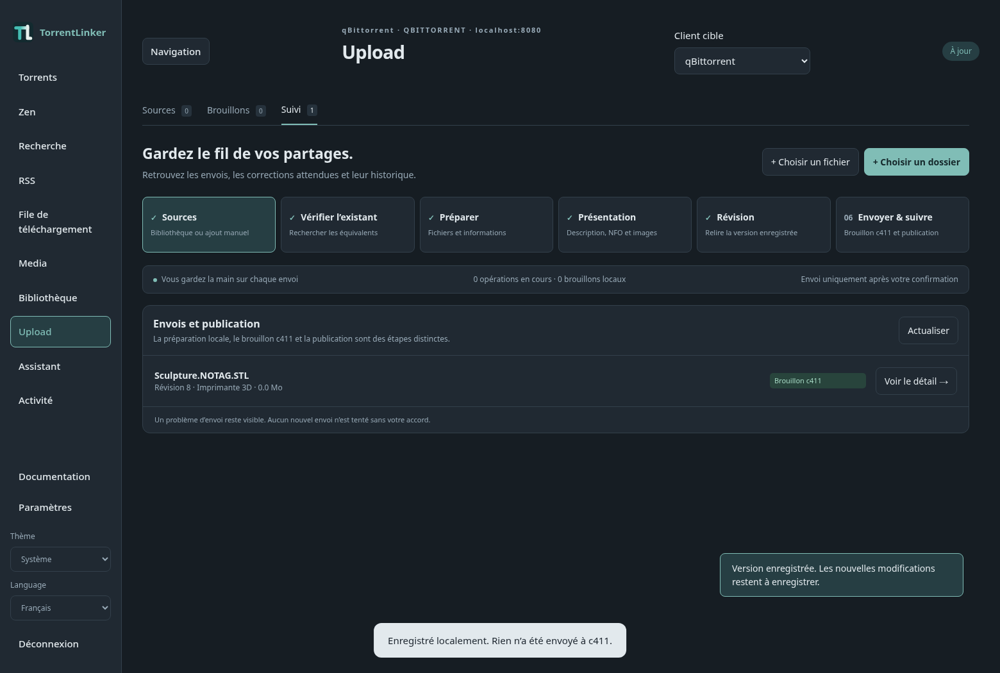

# Préparer un upload c411

Upload reprend la même liste et le panneau d’inspection sur bureau et Web, avec **Sources**, **Brouillons** et **Suivi**. Les sources suggèrent les éléments de la Bibliothèque sans candidat ou dont les candidats ont été écartés. Ce sont des pistes à examiner, pas une preuve d’absence sur le site. Vous pouvez aussi choisir un fichier ou un dossier manuellement. Sur le Web, le sélecteur parcourt le stockage du serveur.

Les étapes sont **Sources → Vérifier l’existant → Préparer → Présentation → Révision → Envoyer et suivre**. Enregistrez le brouillon, relisez la version enregistrée puis confirmez chaque envoi à c411. Une modification invalide cette relecture. La publication finale reste sur c411. Un envoi incertain doit être vérifié sur le site avant de réessayer.

Dans Présentation, **Ajouter une image** ouvre Postimages. Choisissez et hébergez votre image sur cette page ; le lien direct retourné est intégré à la présentation à l’enregistrement. Autorisez la fenêtre surgissante. Si l’hébergement échoue, la description est conservée et vous pouvez réessayer ou coller un lien direct. Les images sont envoyées à cet hébergeur lorsque vous les choisissez sur sa page.

L’éditeur avancé reste disponible pour les options de catégorie, les outils 3D et l’examen détaillé des fichiers. Les sections ci-dessous décrivent cet éditeur.

## Sections de l’éditeur

Le bureau et l’interface web utilisent les mêmes sections pour un brouillon local enregistré :

| Section | Contenu à vérifier |
| --- | --- |
| Détails | Nom de la release, catégorie, sous-catégorie et options. |
| Fichiers et NFO | Liste des fichiers enregistrée et texte du NFO. |
| Description | Texte de présentation et aperçu. |
| Illustration | URL de l’image hébergée et outils de préparation des modèles. |
| Relecture | Refus, avertissements, révision enregistrée et confirmation avant envoi. |

Changer de section n’enregistre pas les modifications. Utilisez **Enregistrer localement** avant de prévisualiser ou d’envoyer la révision enregistrée. Les vues **Brouillons locaux**, **Nouveau brouillon** et **Brouillons c411** distinguent le travail local, la préparation et les brouillons déjà présents sur le tracker.

[Documentation](../../README.md) · [English](../en/upload.md)

1. Dans la Bibliothèque, recherchez les correspondances de votre élément. Les Orphelins sans résultat apparaissent dans **Upload**.
2. Choisissez l’élément et sa catégorie. Relisez les refus et avertissements, le nom, les fichiers, le NFO et la description.
3. Ajoutez l’URL directe de votre image hébergée.
4. Enregistrez dans la file locale et relisez la présentation. Envoyez le brouillon à c411 lorsque tout est prêt, puis publiez-le vous-même sur le site.

Captures de l’interface française en thème sombre, avec des données d’exemple.

## Relire dans la file de brouillons locaux

Cliquez sur **Enregistrer le brouillon** pendant la préparation, ou sur **Enregistrer localement** dans l’éditeur, pour conserver votre travail dans TorrentLinker. Ouvrez **Brouillons locaux** sur ordinateur ou sur le web. Sélectionnez un brouillon pour vérifier ses fichiers, sa description et son NFO, modifier la présentation et enregistrer vos corrections localement.

**Aperçu du brouillon enregistré** ouvre la même fenêtre de relecture que les fiches de l’Assistant : illustration, description, NFO, fichiers, options de catégorie et résultats de la vérification. L’aperçu montre la révision enregistrée ; enregistrez donc vos modifications dans l’éditeur au préalable. Il ne valide ni n’envoie le brouillon.

Les brouillons survivent aux redémarrages et appartiennent au client torrent sélectionné. Ils restent sur l’ordinateur ou le serveur qui exécute TorrentLinker. L’enregistrement ne crée pas de `.torrent`, n’envoie rien à c411 et ne lance aucun seed. Vous pouvez conserver un brouillon incomplet, sans URL d’annonce, puis le corriger plus tard.

Quand tout est prêt, enregistrez vos corrections et choisissez **Envoyer à c411…**. Les deux interfaces demandent de cocher la case de relecture dans la section **Relecture**. TorrentLinker contrôle la révision enregistrée, les fichiers actuels, les options obligatoires, l’image hébergée, la description et le NFO. L’envoi nécessite votre URL d’annonce et les accès aux brouillons c411. Si les fichiers ont changé, enregistrez et relisez à nouveau.

Sur ordinateur, un envoi réussi poursuit le parcours habituel de vérification et de mise en seed. Sur le web et via MCP, la mise en seed est une action distincte. La publication finale reste manuelle sur c411.

Supprimer un brouillon local efface uniquement son entrée dans la file. Vos fichiers et un éventuel brouillon c411 restent intacts. Si un envoi échoue ou est interrompu, vérifiez c411 avant d’autoriser une nouvelle tentative. L’application ne répète pas automatiquement un envoi dont le résultat est incertain.

Les tâches d’upload automatisées enregistrent leur travail ici pour relecture. MCP peut lister, modifier et supprimer ces brouillons, mais l’envoi exige toujours votre approbation de la révision enregistrée. Une modification invalide une ancienne approbation. Voir [Agents et accès MCP](agents.md).

## Préparer des uploads et brouillons c411

**Nouveau brouillon** affiche les Orphelins pour lesquels une recherche n’a trouvé aucune correspondance, dans tous vos dossiers de Bibliothèque. Ces contenus peuvent être absents de c411. Chaque upload appartient à une **catégorie** c411 choisie dans le formulaire. Le Type de contenu du dossier propose une catégorie : Modèles 3D → Imprimante 3D, Films et Séries → Films & Vidéos, etc. Pour le type Autre, choisissez-la vous-même. Les catégories **Imprimante 3D**, **Ebook**, **Audio**, **Films & Vidéos**, **GPS**, **Emulation**, **Applications** et **Jeux Vidéo** sont prises en charge. Les autres indiquent qu’elles ne le sont pas encore. Changer de catégorie recalcule les contrôles, la sous-catégorie, le nom, le NFO et la description.

Renseignez votre **URL d’annonce**, issue de votre profil c411, dans **Paramètres → Connexions**, et utilisez une clé API principale autorisée à gérer les **Brouillons d’upload** (`drafts:rw`). La barre de recherche au-dessus de la liste filtre les Éléments locaux par nom de fichier, en complément du Type de contenu et de **Tout afficher**.

Sélectionner un élément recherche aussi les releases que c411 possède déjà, à partir des mots de son titre et dans sa catégorie. Le bloc repliable **Déjà sur c411** affiche les résultats avec taille, seeders et lien, ou indique qu’aucun résultat n’a été trouvé. Ce résultat est informatif : Team Pending décide des doublons, pas l’application. Chaque élément n’est recherché qu’une fois par session, au moment de sa sélection, avec le même budget de requêtes que les autres recherches.

Pour la 3D, les règles vérifiables automatiquement, comme les formats acceptés et l’interdiction des archives, produisent des **Refus** rouges qui bloquent le brouillon. Les règles qui demandent votre jugement, comme l’interdiction des fichiers de créateurs indépendants qui en vivent ou la cohérence d’un pack, produisent des **Avertissements** orange sans bloquer le brouillon.

L’application propose un nom comme `Petit.Etau.De.Bureau.NOTAG.3MF`, avec des points entre les mots, sans accents et avec `NOTAG` si la source est inconnue. Elle crée un torrent privé avec la taille de pièces attendue par c411 et le champ `source = C411`, afin de conserver le même info-hash après publication, ainsi qu’un NFO listant les fichiers. Le tout est enregistré comme brouillon sur c411. Le torrent est ajouté au client avec des chemins adaptés à vos fichiers, comme pour une remise en seed, et démarre une fois la vérification réussie.

Sous la sous-catégorie, cliquez sur **Options** pour afficher les choix demandés par c411 : langue, genre, format, etc. Cette section est repliée au départ pour laisser davantage de place à la description et au NFO. Vous pouvez la replier sans perdre vos choix ; elle conserve son état ouvert ou fermé pendant la session, même après une actualisation des options. Les erreurs de chargement, le bouton de nouvelle tentative et les options obligatoires manquantes restent signalés lorsque la section est repliée. Les options obligatoires portent un astérisque. Elles sont chargées au premier usage de la sous-catégorie et conservées une semaine ; l’action d’actualisation les recharge. Les règles peuvent préremplir certaines valeurs, mais votre choix reste prioritaire. Une option obligatoire vide bloque le brouillon. Imprimante 3D n’en demande aucune.

Ouvrez la page d’upload de c411, chargez le brouillon, ajoutez l’image demandée et publiez-le sur le site. Voir [ADR-0011](../../adr/0011-uploads-start-as-c411-drafts.md) et le [résumé des règles](../../research/upload-rules.md).

### Image de présentation

L’upload d’image de c411 nécessite une session de navigateur connectée. La section **Illustration** propose les outils de préparation des modèles ; sur le bureau, choisissez **Ouvrir les outils 3D…**. La vue 3D affiche le modèle sélectionné, STL binaire ou ASCII, OBJ ou 3MF, sous un angle isométrique et cadré sur ses dimensions. Faites glisser pour tourner, utilisez la molette pour zoomer, puis double-cliquez ou réinitialisez la vue pour revenir au départ. Un dossier contenant plusieurs modèles propose une liste. Les gros maillages sont chargés en arrière-plan et simplifiés uniquement pour l’affichage.

- **Capturer** enregistre la vue courante en PNG, avec une largeur d’au moins 1 000 pixels.
- Pour un **Pack**, la capture de planche produit une grille d’au plus neuf modèles, chacun en vue isométrique avec son nom de fichier.
- **Ouvrir le dossier** affiche ces images, rangées dans `uploads/<release name>/`, jamais dans la Bibliothèque. Ajoutez celle de votre choix sur c411 en relisant le brouillon ; la description conserve un emplacement `[img]…[/img]`.

Si vous hébergez l’image ailleurs, collez son lien direct dans **URL de l’image hébergée**. Le bouton d’hébergement ouvre Postimages. L’image est incluse dans la description du brouillon même après modification du texte ; changer l’URL remplace l’image sans réinitialiser la présentation.

STEP, GCODE, BLEND, F3D, SLDPRT et FCStd n’ont pas d’aperçu : préparez leur image vous-même. Le rendu nécessite OpenGL ; s’il est indisponible, la vue et les captures affichent la raison de leur indisponibilité.

## Règles selon la catégorie

Consultez les [règles par catégorie](upload-categories.md) pour les formats, noms, contrôles et métadonnées des livres numériques, de l’audio, des vidéos, du GPS, de l’émulation, des applications et des jeux.

[Documentation](../../README.md) · [English](../en/upload.md)

### Compléter la présentation avant d’afficher les fiches

L’Assistant utilise `preview_upload` pour examiner un élément de la Bibliothèque, `get_upload_requirements` pour lire le modèle de sa catégorie et `save_upload_draft` pour enregistrer ou corriger le brouillon. Ces outils sont aussi accessibles par MCP. Les identifiants des catégories Upload diffèrent de ceux du Catalogue ; appeler `get_upload_requirements` sans catégorie donne la liste des identifiants et sous-catégories pris en charge.

Un brouillon incomplet peut être enregistré localement. La vérification indique précisément chaque champ manquant dans la description ou le NFO. Conservez les libellés techniques du modèle et remplissez la section Présentation/Synopsis. Une valeur inconnue ou un texte à compléter ne compte pas comme un champ rempli. Certaines exigences dépendent du contenu : plateforme WEB, détails d’un livre audio, profondeur du son sans perte, durée de chaque piste. La langue des métadonnées EPUB est contrôlée lorsqu’elle est disponible ; déclarer « Français » ne rend pas admissible un fichier dans une autre langue.

`present_upload_drafts` refuse les fiches incomplètes. L’Assistant doit corriger le formulaire enregistré puis présenter sa nouvelle révision, ou vous demander les informations manquantes. L’aperçu de la file reste accessible pour relire un travail en cours. Chaque envoi revérifie les champs avant de créer le torrent ou de contacter c411, sur ordinateur comme sur le web. Des champs complets ne garantissent ni leur exactitude ni l’acceptation par le site : les refus de catégorie, les doublons et la relecture restent à traiter. Conservez les NFO originaux ; les rapports vidéo MediaInfo sont reconnus sans réécriture.

