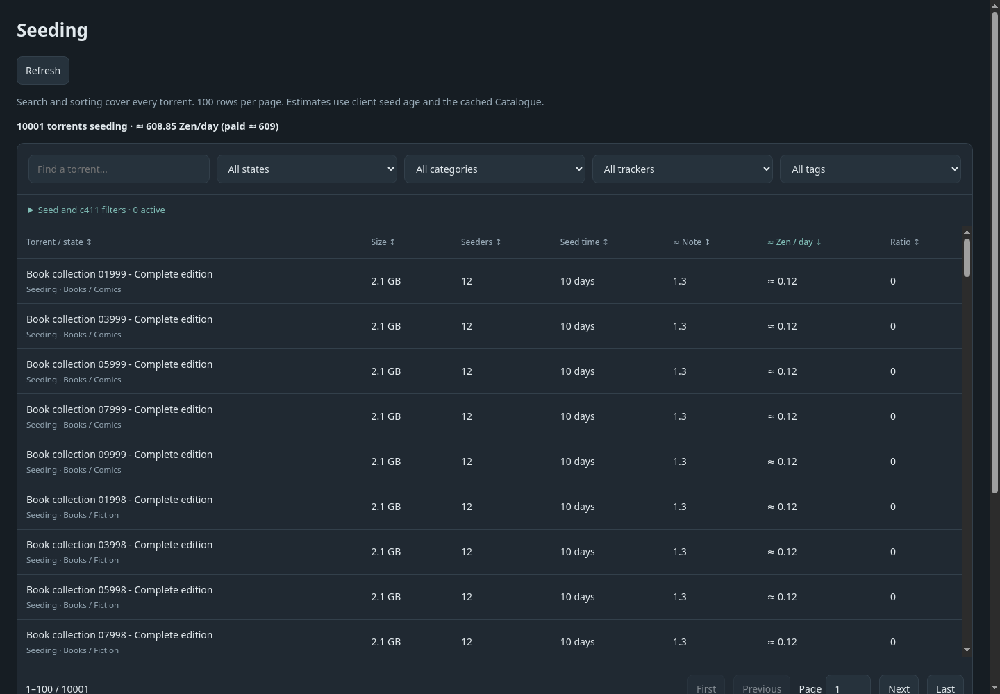
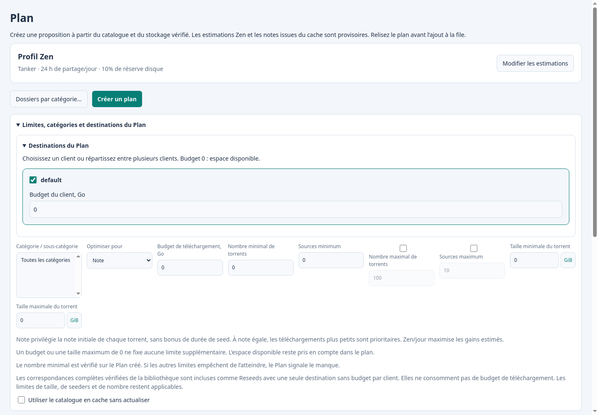
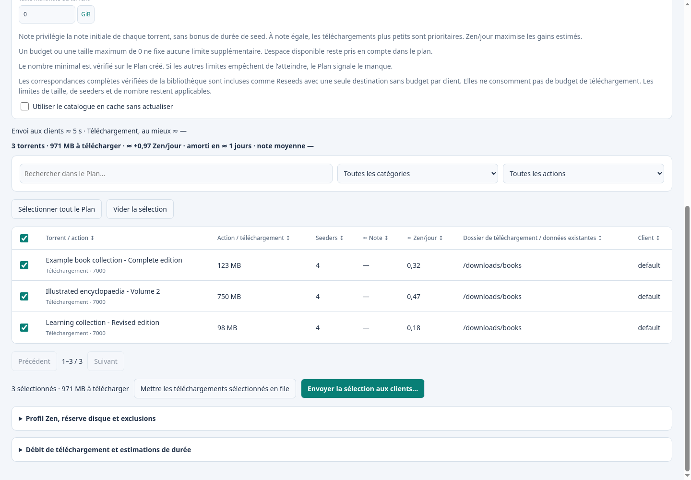
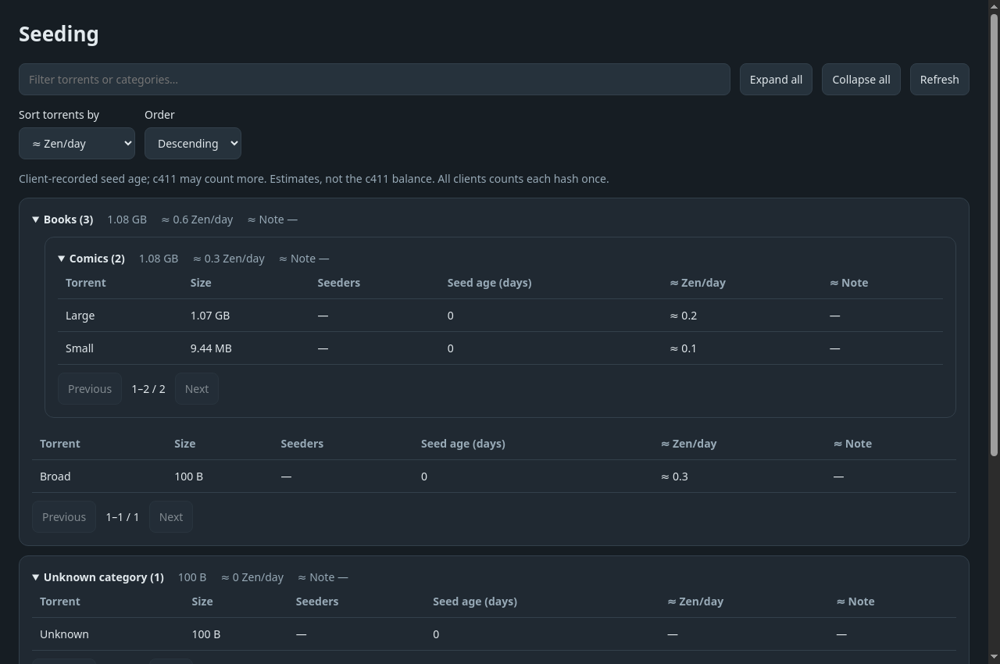
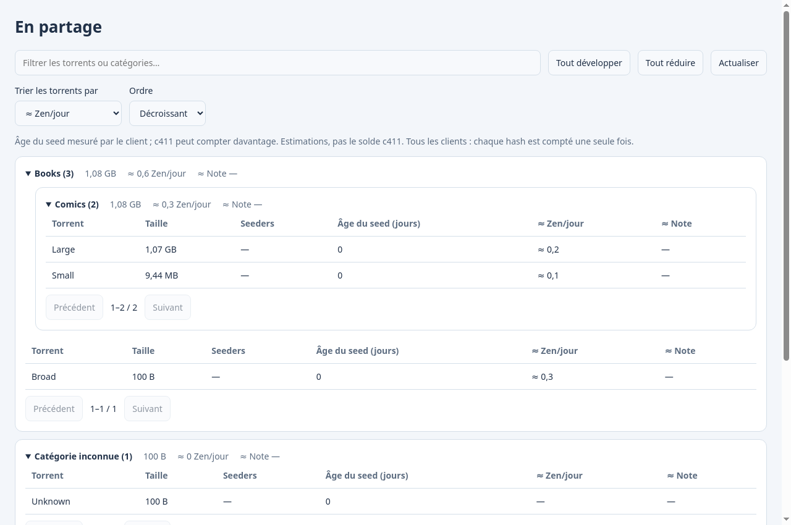
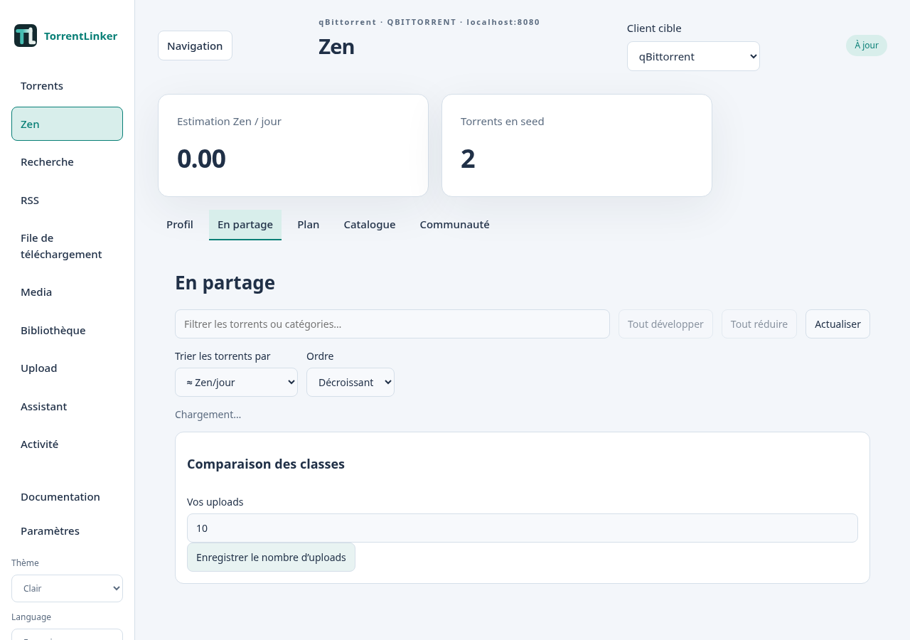
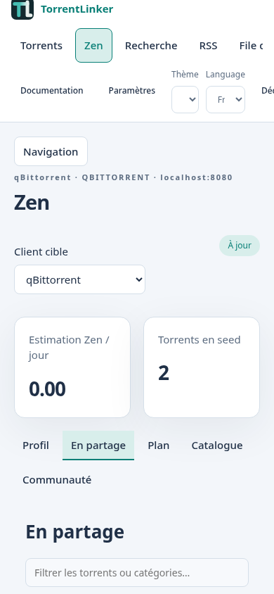

# Shared Seeding, #94

Desktop and Web load `static/seeding/view.html`. The page owns the category tree, bounded torrent pages, filter, numeric sort, expand/collapse controls, estimates and class comparison. The old native tree, native comparison widgets and Web renderer are removed.

## Large-library correction

The owner's subsequent review rejected the expanding torrent tables for libraries above 10,000 torrents and requested the current Torrents list rows for Plan. Seeding now displays one globally paged torrent list below the approved Torrents filters. A parent category includes its descendants. Category totals remain in a collapsed section below the table. Expanding categories changes only that navigator; it never inserts more torrent rows. Search and numeric sorting operate across all matching torrents before paging. First, previous, next, last and page-number navigation keep each rendered page at 100 rows.

Torrents, Plan and Seeding load the same `panel/torrent-list.css` row styles. Plan keeps its selection, review, queue and send behavior, with action metadata below the torrent name and aligned metrics. Full destination paths remain available on hover and in the send review. The owner also reported missing Plan controls in the prototype. The prototype omitted them, while the shared app started them collapsed. Plan limits, category selection, optimisation, destinations and cached-catalogue controls now start expanded and the card can be collapsed without losing values. Desktop and browser regressions check their visibility without opening any disclosure; the browser regression first failed before this correction. The prototype now includes these controls and preserves their values across selection and language changes.

The 10,001-torrent service and desktop regressions first failed against the previous implementation, then passed. The browser checks cover global search, numeric sorting, the final page and fewer than 1,600 DOM elements at both `/` and `/tl`. Existing category expansion, refresh recovery and client-switch checks still apply to the category navigator.

Real-display captures use a 10,001-torrent fixture for Seeding and the corrected Plan rows in English/dark and French/light. Plan was checked in a separate process after a combined-run capture was black despite correct DOM content. The separate-process capture rendered correctly.

Both hosts use `web.seeding.seeding_page`, which computes category aggregates, unknown values and account totals independently of the requested row page. Desktop page calculations run off the GUI thread; the hidden desktop tab keeps only its latest observation until opened. The existing desktop update signals still feed the Zen band, Library estimates and Reading Room. Refreshing observations remains separate from repainting the page.

Expanded categories use stable category IDs. Desktop remembers them in the owner's QSettings, scoped by settings path and client, and imports the previous native tree preference once. Web remembers them in owner-browser storage scoped by server base path and client. Filtering opens matching ancestors without changing saved expansion. Sort, filter and typed upload counts survive environment updates.

## Validation

The first desktop interface regression failed against the native renderer, then passed with the shared page. The desktop/controller group passed 84 checks and exposed two old widget assertions; those checks passed after moving them to observed data. Browser acceptance passes at both `/` and `/tl`, covering grouping, numeric sort, filter, reload, per-client expansion, client refresh, upload estimates, French/light and 390-pixel layout. The broader browser setup workflow and shared Plan regression also pass with Seeding installed.

An actual desktop display check on DP-4 rendered English/dark and French/light. The French view and the narrow Web view were inspected. Tests use temporary settings, databases and simulated clients. Ruff and mypy pass.

The full local suite passed with 2,130 tests and 213 skips. Acceptance review found that a browser reload during a refresh could leave controls disabled after completion. The added browser regression reproduced it against the first commit. Recovered refresh jobs now resume completion/error handling, and refresh controls disable immediately while submitting a request.

## Retained platform differences

The shared HTML table replaces native column-width dragging and native row highlighting. It supports text selection and horizontal scrolling for the torrent columns. Category expansion is saved by the desktop owner or Web browser, so it does not transfer between browsers or hosts. Desktop category-tag reconciliation results remain visible; Web continues to show client observation failures from its existing API.

## Approved filter component correction

Seeding and Torrents now share `panel/torrent-filters.js`, including search, state/category/tracker/tag selectors, expandable Seed and c411 metrics, clear filters and independent MiB/GiB toggles. Column headers control sorting; the separate sort dropdown is removed. Filters apply before global pagination. Unknown metrics do not match numeric constraints, and tracker options expose safe host names only.

The combined Plan, Seeding, Torrents and controller regression group passed 132 checks. This includes desktop and browser workflows, the 10,001-row fixture at both `/` and `/tl`, and the older UI workflow whose obsolete category selector caused the previous CI failure. Ruff and mypy pass. The captures above were refreshed from the actual desktop display for this correction.
